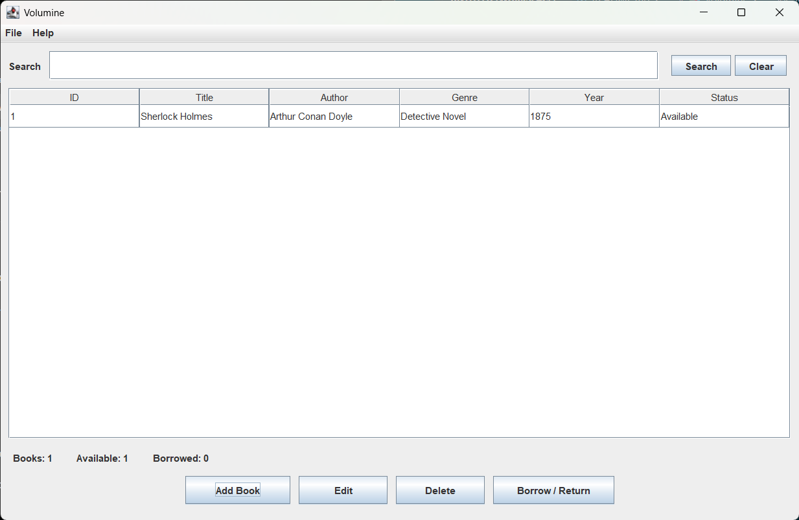

# 📚 Volumine

Volumine is a desktop library management application built with Java Swing. It allows users to organize, manage, and track books through a clean graphical interface without requiring an internet connection or external database.

---

## Features

- 📖 Add new books
- ✏️ Edit existing books
- 🗑 Delete books
- 🔄 Borrow / Return books
- 🔍 Search by title, author, or genre
- 📊 Live library statistics
- 💾 Automatic local data saving
- 🖥 Modern Swing interface

---

## Technologies

- Java
- Java Swing
- Object-Oriented Programming
- Serialization
- Java Collections Framework

---

## Screenshots

### Main Window

### Dynamic Attention Graph


---

## Project Structure

```
Volumine-Library-Manager
│
├── Book.java
├── Library.java
├── LibraryGUI.java
├── FileManager.java
├── Main.java
│
├── data/
│   └── books.dat
│
└── README.md
```

---

## Getting Started

### Clone the repository

```bash
git clone https://github.com/kennykrichardson/Volumine-Library-Manager.git
```

### Compile

```bash
javac *.java
```

### Run

```bash
java Main
```

---

## Future Improvements

- SQLite database support
- Book cover images
- Dark Mode
- Export to CSV
- Categories and tags
- Lending history
- Sorting and filtering
- Dashboard analytics

---

## Learning Outcomes

This project demonstrates:

- Object-Oriented Design
- GUI Development with Swing
- Event Handling
- File Persistence
- Java Collections
- Desktop Application Development

---

## Author

**Kenny Richardson**

GitHub: https://github.com/kennykrichardson

---

## License

This project is licensed under the MIT License.
